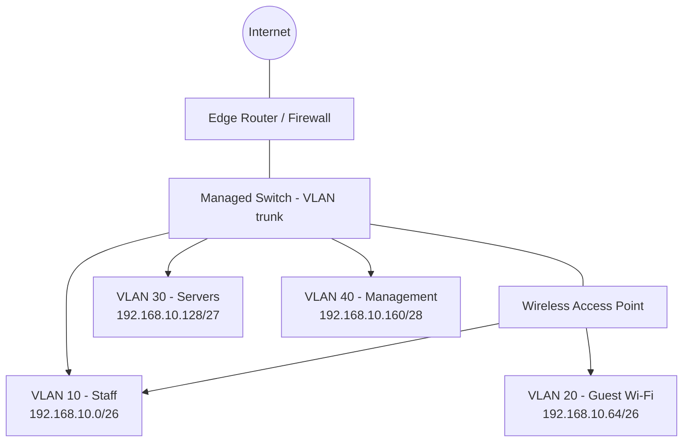

# Proposed Network Topology

The following Mermaid diagram shows the logical design. GitHub can render Mermaid diagrams in Markdown files.

## Traffic flow

1. Office devices connect to the managed switch or wireless access point.
2. The switch assigns traffic to the appropriate VLAN based on the access port or wireless SSID configuration.
3. Devices communicate within their own VLAN according to local switching rules.
4. Traffic between VLANs passes through the Layer-3 gateway/firewall, where access-control rules are applied.
5. Internet-bound traffic passes through the edge router/firewall.
6. Guest traffic is restricted to internet access and cannot reach internal office subnets.

## Physical/logical equipment

- ISP modem/ONT: provides the internet handoff.
- Edge router/firewall: provides WAN connectivity, routing, NAT, and policy enforcement.
- Managed switch: provides VLAN-capable wired connectivity.
- Wireless access point: provides separate staff and guest SSIDs.
- Internal server/VM: provides approved internal services if required.

## Design note

The diagram is conceptual. It does not specify a particular vendor, model, cabling layout, or exact port configuration.
